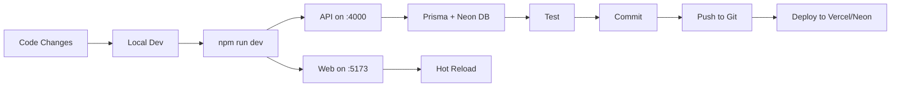

# BookLeaf Project Workflow

## Architecture Overview

```mermaid
graph TB
    subgraph "Frontend (Vue 3 + Vite)"
        A[Vue App] --> B[Router]
        B --> C[Author Portal]
        B --> D[Admin Portal]
        C --> E[BooksView]
        C --> F[TicketsView]
        C --> G[TicketDetailView]
        D --> H[QueueView]
        D --> I[TicketDetailView]
    end
    
    subgraph "API Layer"
        J[Express API - Local/Neon] --> K[Auth Middleware]
        J --> L[Ticket Routes]
        J --> M[AI Service]
        K --> N[JWT Auth]
        L --> O[Prisma ORM]
        M --> P[OpenRouter SDK]
    end
    
    subgraph "Database"
        O --> Q[(Neon PostgreSQL)]
        Q --> R[Users]
        Q --> S[Books]
        Q --> T[Tickets]
        Q --> U[TicketMessages]
        Q --> V[KbChunks]
    end
    
    subgraph "AI/ML"
        P --> W[nvidia/nemotron-3.5-70b:free]
        P --> X[anthropic/claude-3.5-sonnet]
        P --> Y[openai/gpt-4o-mini]
    end
    
    subgraph "Deployment"
        A --> Z[Vercel - Frontend]
        J --> AA[Neon - Backend/DB]
        Z --> BB[Serverless Functions]
        BB --> CC[/api routes]
    end
    
    A --> J
```

## Data Flow

```mermaid
sequenceDiagram
    participant U as User
    participant V as Vue Frontend
    participant API as Express API
    participant DB as Neon PostgreSQL
    participant AI as OpenRouter
    
    U->>V: Login
    V->>API: POST /api/auth/login
    API->>DB: Find user by email
    DB-->>API: User data
    API-->>V: JWT token
    
    U->>V: Create Ticket
    V->>API: POST /api/tickets
    API->>DB: Create ticket + message
    API->>AI: Classify ticket
    AI-->>API: Category/Priority
    API->>DB: Update ticket
    DB-->>API: Ticket data
    API-->>V: Ticket created
    
    U->>V: Request AI Draft
    V->>API: POST /api/ai/generate-draft
    API->>AI: Generate draft
    AI-->>API: Draft text
    API-->>V: Draft response
```



## Development Workflow



## Deployment Flow

```mermaid
flowchart TD
    A[Build Frontend] --> B[Vite Build]
    B --> C[apps/web/dist]
    C --> D[Vercel Deploy]
    D --> E[Serverless Functions]
    E --> F[/api routes]
    
    G[Neon Setup] --> H[PostgreSQL]
    G --> I[Functions]
    G --> J[Realtime]
    H --> K[Prisma Migrations]
    K --> L[Seed Data]
    L --> M[12 Users, 18 Books, 0 Tickets]
    
    N[OpenRouter Setup] --> O[AI Client]
    O --> P[Classify & Generate]
```

## Tech Stack

| Component | Technology | Purpose |
|-----------|------------|---------|
| Frontend | Vue 3 + TypeScript + Vite | UI Framework |
| Backend | Express.js + TypeScript | API Server |
| Database | Neon PostgreSQL + Prisma ORM | Data Storage |
| AI | OpenRouter SDK | AI Classification & Draft Generation |
| Auth | JWT | Authentication |
| Deployment | Vercel (Frontend + Serverless) + Neon (DB) | Hosting |

## Key Features

1. **Author Portal**: Create tickets, view books, get AI assistance
2. **Admin/Support Portal**: Manage tickets, respond to authors, view queue
3. **AI Integration**: Auto-classify tickets and generate response drafts
4. **Real-time Ready**: Neon Realtime configured
5. **Cloud Native**: Fully deployed on Vercel + Neon
