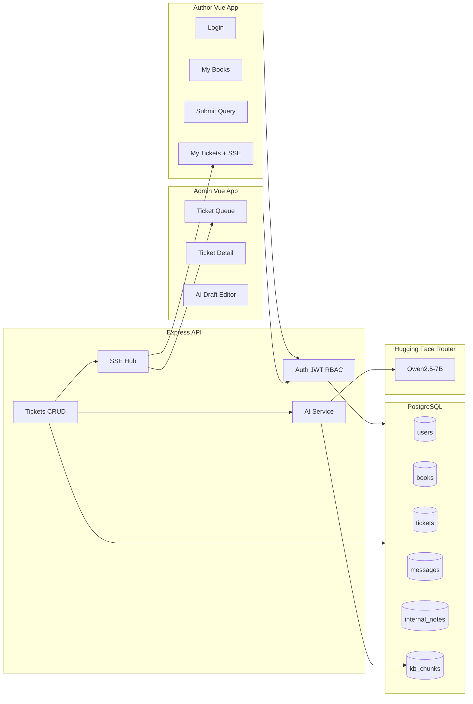

# BookLeaf Author Support Portal — Implementation Plan

## Locked decisions

- **Stack:** Vue 3 (Vite SPA) + Node.js (Express) + PostgreSQL
- **AI (Admin only):** Hugging Face Router via `openai` SDK — model `Qwen/Qwen2.5-7B-Instruct:featherless-ai`, `baseURL: https://router.huggingface.co/v1`, key `HF_TOKEN` in env only
- **AI flow:** Classify + priority on ticket create (async); draft response on admin open ticket; both use RAG over Knowledge Base + inject author/book data into drafts
- **Real-time:** Server-Sent Events (SSE) for ticket updates
- **Auth:** Email/password + JWT; roles `author` | `admin`
- **File attach:** UI-only (no upload storage)
- **Deploy target:** Railway or Render (API + Postgres + static Vue)

**Security note:** You pasted `HF_TOKEN` in chat. Do not commit it. Put it only in `.env` (gitignored). Rotate the token on Hugging Face after this assignment if the chat/repo may be shared.

---

## Architecture



**Monorepo layout**

```
bookleaf/
  apps/web/          # Vue 3 + Vite + Vue Router + Pinia
  apps/api/          # Express + Prisma (or node-pg)
  packages/shared/   # shared types/constants (optional, keep thin)
  bookleaf_sample_data.json
  README.md
  .env.example
```

---

## Phase 0 — Foundation (Day 0–0.5)

1. Scaffold monorepo: Vue Vite app + Express API + PostgreSQL connection.
2. Add Prisma (or Knex) schema and migrate:
   - `users` — id, email, password_hash, name, role, author_id (nullable), phone, city, joined_date
   - `books` — all fields from sample JSON (nullable MRP/isbn/status for in-production books)
   - `tickets` — id, author_id, book_id nullable, subject, description, status, category, priority, category_override, priority_override, assigned_admin_id, created_at, updated_at
   - `ticket_messages` — id, ticket_id, sender_role, body, created_at
   - `internal_notes` — id, ticket_id, admin_id, body, created_at
   - `kb_chunks` — id, category (nullable), title, content, embedding vector (or text search if embeddings unavailable)
3. Seed script: load [`bookleaf_sample_data.json`](bookleaf_sample_data.json); create 10 authors with a shared demo password (e.g. `Author@123`); create 1–2 admins (e.g. `admin@bookleaf.com` / `Admin@123`); seed KB chunks from assignment Knowledge Base sections.
4. Express middleware: JWT auth, role guard, Zod/Joi validation, consistent error shape `{ error, details }`.
5. `.env.example`: `DATABASE_URL`, `JWT_SECRET`, `HF_TOKEN`, `PORT`, `CORS_ORIGIN`. Never hardcode secrets.

---

## Phase 1 — Author Portal (build first)

### 1.1 Auth

- `POST /api/auth/login` — email/password → JWT + role
- `GET /api/auth/me`
- Vue login page; store token; route guards by role
- Authors only see own data (enforce in every query with `author_id` from JWT)

### 1.2 My Books

- `GET /api/authors/me/books`
- Table/list: title, ISBN, genre, publication date, status, MRP, copies sold, royalty earned/paid/pending
- Handle edge cases from seed: null MRP/publication_date, `In Production - Cover Design` / `Typesetting`, zero royalties, null payout dates

### 1.3 Submit Support Query

- Form: book dropdown (`General / Account Level` + author’s books), subject, description, optional file input (UI only — ignore file bytes)
- `POST /api/tickets` — creates ticket `Open`, stores message; returns ticket
- After create, API enqueues async AI classify+priority (Phase 2); ticket creation must succeed even if AI fails

### 1.4 My Tickets + near-real-time

- `GET /api/tickets/mine` — list with status, subject, timestamps
- `GET /api/tickets/:id` — detail + messages (no internal notes)
- SSE: `GET /api/tickets/mine/stream` — push on new admin reply / status change
- Statuses: Open | In Progress | Resolved | Closed

**Author portal done when:** login → books → create ticket → see ticket → receive admin reply without full page refresh.

---

## Phase 2 — Admin Portal + AI (build second)

### 2.1 Ticket Queue

- `GET /api/admin/tickets` — filters: status, category, priority, date range; sort urgent+oldest first (Critical/High first, then `created_at` ASC)
- Visual cues for Critical/High and aging Open tickets
- `PATCH /api/admin/tickets/:id` — status, category override, priority override, assign-to-self
- `POST /api/admin/tickets/:id/notes` — internal notes (author never sees)
- `POST /api/admin/tickets/:id/responses` — send edited reply → `ticket_messages` + SSE to author

### 2.2 AI client (server-only)

```js
// apps/api/src/services/ai/client.js
import { OpenAI } from "openai";
export const hf = new OpenAI({
  baseURL: "https://router.huggingface.co/v1",
  apiKey: process.env.HF_TOKEN,
});
const MODEL = "Qwen/Qwen2.5-7B-Instruct:featherless-ai";
```

Wrap every call: timeout, try/catch, on failure return `null` and log — never block ticket create or force empty admin UI.

### 2.3 RAG over Knowledge Base

1. Split assignment KB into chunks by section (Company, Royalty, ISBN, Printing, Distribution, Production, Tone, Sample Q&A).
2. On seed, store chunks in `kb_chunks` with `category` tags matching the six ticket categories.
3. **Retrieve:** for a ticket, pull top chunks by:
   - category match (if known) + keyword/trigram/`tsvector` similarity on subject+description  
   - Keep token budget tight: ~3–5 chunks max, not the full KB every time (cost awareness).
4. Optional stretch: HF embeddings for semantic search; default to category + full-text so it works without a second model.

### 2.4 Auto-classification + priority (on ticket create)

- Async job after `POST /api/tickets`:
  - Prompt: system role as BookLeaf classifier; user message = subject + description; ask for JSON `{ category, priority, rationale }`
  - Categories exactly: Royalty & Payments | ISBN & Metadata Issues | Printing & Quality | Distribution & Availability | Book Status & Production Updates | General Inquiry
  - Priority: Critical | High | Medium | Low
- Persist AI values; admin overrides stored separately so “AI vs human” is auditable
- If HF down/rate-limited: leave category/priority null or `General Inquiry` / `Medium` fallback; ticket still Open

### 2.5 AI-drafted response (on admin open)

- `POST /api/admin/tickets/:id/ai-draft` (or auto-fetch when detail loads)
- RAG retrieve KB chunks
- **Also inject author context:** name, book title/ISBN/status, royalty earned/paid/pending, last payout, production stage if in-production
- Prompt includes: tone guidelines + retrieved KB + sample response patterns + author data + original query
- Return draft text; admin edits in textarea; send via responses endpoint
- If AI fails: show empty editor + toast “Draft unavailable — write manually”

### 2.6 Prompt strategy (document in README)

- System prompt: BookLeaf support voice (empathize, specific numbers, own faults, clear next step)
- Structured outputs for classify; free-form for draft
- Token discipline: RAG subset + one book’s fields, not full ticket history dump unless needed

---

## Phase 3 — API completeness & docs

REST surface (consistent `/api/...`):

| Area | Endpoints |
|------|-----------|
| Auth | `POST /login`, `GET /me` |
| Author | `GET /authors/me/books`, `GET/POST /tickets`, `GET /tickets/:id`, SSE stream |
| Admin | `GET /admin/tickets`, `GET /admin/tickets/:id`, `PATCH ...`, notes, responses, `ai-draft` |

- Swagger (swagger-jsdoc) or Postman collection + README endpoint table
- RBAC: authors 403 on `/admin/*`; authors cannot read others’ tickets

---

## Phase 4 — Deploy, README, write-up

1. Deploy Postgres + API + Vue static (or serve Vue from Express in prod)
2. Seed production DB with sample data
3. README: setup, architecture, AI (HF Qwen, RAG, degradation, cost), test credentials, known limits
4. 1-page write-up: priorities, trade-offs, production evolution
5. Private GitHub repo; collaborator email when provided

---

## Requirement traceability (every brief line → plan step)

**A. Author Portal**

| Requirement | Plan step |
|-------------|-----------|
| Email/password auth; own data only | Phase 1.1 + RBAC |
| My Books fields + statuses | Phase 1.2 + seed edge cases |
| Submit query form + UI-only attach | Phase 1.3 |
| My Tickets statuses + admin replies | Phase 1.4 |
| Real-time / near-real-time | SSE Phase 1.4 |

**B. Admin Portal**

| Requirement | Plan step |
|-------------|-----------|
| Queue + filters + urgency | Phase 2.1 |
| AI auto-classification + override | Phase 2.4 |
| AI priority + override | Phase 2.4 |
| AI draft from query + KB + edit/send | Phase 2.5 + RAG 2.3 + author inject |
| Status, internal notes, assign self | Phase 2.1 |

**C. API** — Phase 0 + 3  
**D. AI** — Phase 2.2–2.6 (keys in env, graceful degrade, token awareness, model justified in README)  
**Sample data** — Phase 0 seed  
**Deliverables** — Phase 4  

---

## Suggested 5-day build order

1. **Day 1:** Foundation + seed + auth + My Books  
2. **Day 2:** Tickets create/list/detail (author) + SSE stub  
3. **Day 3:** Admin queue + ticket management + author SSE wired  
4. **Day 4:** HF client + RAG + classify/priority + draft with author context + degradation  
5. **Day 5:** Polish edge cases, API docs, deploy, README, write-up  

If short on time: cut embeddings (keep category+FTS RAG), keep file attach UI-only, keep SSE simple (or 5s polling fallback).

---

## Out of scope / explicit non-goals

- Pixel-perfect UI  
- Real file upload/storage  
- OTP/social login  
- Public repo  
- AI features on the author-facing UI